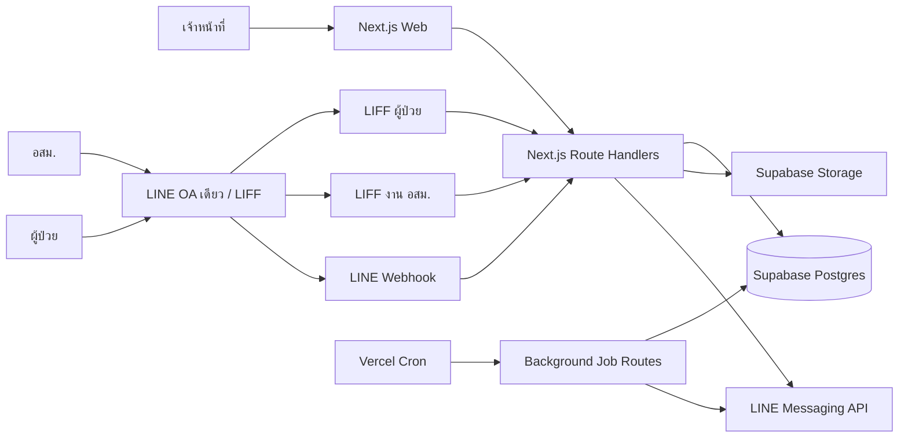

# Implementation Plan — ระบบติดตามผู้ป่วยขาดนัด รพ.สต. สระโคล่

> เอกสารฉบับนี้เป็นแผนพัฒนาจาก MVP ปัจจุบันไปสู่ระบบที่ใช้งานจริง ครอบคลุมเว็บเจ้าหน้าที่ ระบบ อสม. LINE OA/LIFF การติดตามผู้ป่วยขาดนัด ระบบคิว QR และการดูแลข้อมูลสุขภาพ

## 1. เป้าหมายของระบบ

พัฒนารูปแบบการพยาบาลเพื่อติดตามผู้ป่วยโรคความดันโลหิตสูงที่ขาดนัดให้ครบวงจร ตั้งแต่รับข้อมูลนัด ตรวจพบการขาดนัด มอบหมายผู้ติดตาม ประเมินสาเหตุ ให้คำปรึกษา นัดใหม่ และยืนยันว่าผู้ป่วยกลับมารับบริการจริง

ผลลัพธ์หลักที่ระบบต้องทำได้:

1. เจ้าหน้าที่นำเข้ารายการนัดและผลการมารับบริการจาก Excel/CSV ได้อย่างปลอดภัย
2. ระบบระบุผู้ขาดนัดโดยอัตโนมัติตามกติกาของหน่วยบริการ
3. เจ้าหน้าที่มอบหมาย อสม. และติดตามสถานะงานได้
4. อสม. เปิดงานที่ได้รับมอบหมายและบันทึกผลติดตามได้จากโทรศัพท์
5. ผู้ป่วยเห็นวันนัดที่อ่านง่าย ได้รับสื่อสุขภาพ และแจ้งปัญหาได้ผ่าน LINE OA
6. การนัดใหม่ต้องผ่านเจ้าหน้าที่ ระบบห้ามเปลี่ยนวันนัดเองจากคำตอบของผู้ป่วย
7. ระบบยืนยันการกลับมารับบริการจากผลบริการ, QR check-in หรือเจ้าหน้าที่ และปิดเคสได้ถูกต้อง
8. ทุกการเปลี่ยนแปลงข้อมูลสำคัญสามารถตรวจสอบย้อนหลังได้

## 2. หลักการออกแบบที่ต้องยึดถือ

- **ฐานข้อมูลเป็นแหล่งข้อมูลหลัก:** LINE เป็นช่องทางสื่อสาร ไม่ใช่เวชระเบียน
- **ไม่เลื่อนนัดอัตโนมัติ:** ผู้ป่วยแจ้งปัญหาได้ แต่เจ้าหน้าที่เป็นผู้ประสานและยืนยันนัดใหม่
- **ยืนยันตัวตนก่อนแสดงข้อมูล:** หน้าผู้ป่วยต้องผูก LINE user กับผู้ป่วยที่ยืนยันแล้ว
- **ข้อมูลเท่าที่จำเป็น:** ข้อความ LINE ไม่ควรมี HN, เลขบัตรประชาชน หรือรายละเอียดโรคเกินจำเป็น
- **ทุกงานต้องมีสถานะ:** ต้องทราบว่าใครรับผิดชอบ ทำถึงขั้นไหน และเคสปิดด้วยเหตุผลใด
- **รองรับการส่งซ้ำ:** Webhook, Cron และการนำเข้าต้องทำซ้ำได้โดยไม่เกิดข้อมูลซ้ำ
- **ใช้มือถือได้จริง:** หน้าผู้ป่วยและ อสม. ต้องทำงานได้ตั้งแต่หน้าจอ 320px

## 3. ขอบเขตระบบ

### 3.1 เว็บเจ้าหน้าที่

- เข้าสู่ระบบด้วย Supabase Auth
- Dashboard สรุปงานตามช่วงเวลาและสถานะ
- นำเข้าไฟล์นัดและผลบริการ
- ตรวจข้อมูลก่อนยืนยันนำเข้า พร้อมรายงานแถวที่ผิด
- ทะเบียนผู้ขาดนัด ค้นหาและกรองได้จริง
- เปิดรายละเอียดเคสและประวัติการติดตาม
- ประเมินสาเหตุและบันทึกกิจกรรมการพยาบาล
- มอบหมาย/เปลี่ยนผู้รับผิดชอบ อสม.
- สร้างและยืนยันนัดใหม่
- ยืนยันการกลับมารับบริการและปิดเคส
- จัดการเจ้าหน้าที่ อสม. และสิทธิ์ใช้งาน
- ดูสถานะการส่งข้อความและข้อผิดพลาด

### 3.2 ระบบ อสม.

- ใช้ LINE OA บัญชีเดียวกับผู้ป่วย แต่ผูกบัญชีเป็นบทบาท `volunteer`
- รับ Push Message เมื่อมีงานใหม่ งานใกล้เกิน SLA หรือมีข้อความจากพยาบาล
- เปิด LIFF “งานของฉัน” จากข้อความหรือ Rich Menu ของ อสม.
- ยืนยันตัวตนด้วย LIFF ID token และบัญชีที่เจ้าหน้าที่อนุมัติก่อนเห็นรายละเอียด
- เห็นเฉพาะงานที่ได้รับมอบหมาย
- ดูข้อมูลขั้นต่ำที่จำเป็นต่อการติดตาม
- กดโทรหรือเปิดแผนที่เมื่อมีข้อมูลและได้รับอนุญาต
- บันทึกผลการติดต่อ/เยี่ยมบ้าน
- ระบุว่า ติดต่อได้, ติดต่อไม่ได้, ปฏิเสธ, ย้ายที่อยู่, ต้องให้พยาบาลช่วย หรือมีภาวะเร่งด่วน
- ส่งคำขอให้พยาบาลประสานต่อ
- ดูประวัติการส่งงานของตนเอง

### 3.3 LINE OA และ LIFF สำหรับผู้ป่วยและ อสม.

ระบบใช้ **LINE OA เดียว** สำหรับทั้งสองกลุ่ม แล้วกำหนด Rich Menu, หน้าปลายทาง และสิทธิ์ตามบัญชีที่ผูกไว้ ผู้ใช้ที่เป็นทั้งผู้ป่วยและ อสม. ต้องมีหน้าเลือกโหมดและสลับบริบทได้โดยไม่รวมข้อมูลของสองบทบาทเข้าด้วยกัน

- Rich Menu ผู้ป่วย: วันนัดของฉัน, ความรู้, แจ้งปัญหา, ขอคำปรึกษา
- Rich Menu อสม.: งานของฉัน, งานเร่งด่วน, บันทึกผล, ติดต่อพยาบาล
- ผูกบัญชี LINE กับผู้ป่วยด้วยรหัสครั้งเดียว
- ผูกบัญชี LINE กับ อสม. ด้วยรหัสครั้งเดียวที่เจ้าหน้าที่สร้าง และตรวจว่าเป็น อสม. active
- แสดงนัดถัดไปจากฐานข้อมูลจริง
- ตัวอักษรใหญ่ ภาพประกอบ และภาษาที่เข้าใจง่าย
- เพิ่มนัดลงปฏิทิน
- เลือกเหตุผลที่อาจมาตามนัดไม่ได้
- ส่งคำขอให้เจ้าหน้าที่ติดต่อกลับ
- อ่านสื่อสุขภาพและตอบคำถามสะท้อนความเข้าใจ
- จองคิว/เลือกช่วงเวลาที่เปิดให้บริการ
- แสดง QR check-in ของนัดที่ยืนยันแล้ว

### 3.4 งานอัตโนมัติ

- ส่งเตือนก่อนวันนัด
- ระบุผู้ขาดนัดหลังพ้นเวลาที่กำหนด
- สร้างเคสติดตามเมื่อเป็นผู้ขาดนัด
- แจ้ง อสม. เมื่อได้รับมอบหมาย
- เตือนงานที่ยังไม่มีผลติดตาม
- ประมวลผลผลบริการที่นำเข้าและปิดเคสที่กลับมาแล้ว
- retry การส่ง LINE ที่ล้มเหลว

## 4. สถานะปัจจุบัน

| ความสามารถ | สถานะปัจจุบัน | งานที่ต้องทำต่อ |
| --- | --- | --- |
| Supabase Auth เจ้าหน้าที่ | มี login และตรวจบทบาท | เพิ่ม logout, reset password, จัดการผู้ใช้ และหน้า unauthorized |
| นำเข้า Excel/CSV | อ่านไฟล์และ upsert ได้ | เพิ่ม preview, mapping, validation รายแถว, batch history และ import ผลบริการให้ถูกประเภท |
| ทะเบียนผู้ขาดนัด | อ่านรายการ `missed` ได้ | เพิ่ม job ตัดขาดนัด, search/filter/pagination และ empty/error state |
| แบบติดตาม | บันทึกสาเหตุ กิจกรรม นัดใหม่ได้ | โหลด อสม. จาก DB, ประวัติกิจกรรม, validation และ transaction |
| ระบบ อสม. | มี role/schema บางส่วน | ยังไม่มีหน้าใช้งาน งานมอบหมาย หรือการแจ้งเตือน |
| หน้าผู้ป่วย | มี UI ตัวอย่าง | ต้องใช้ LIFF identity และข้อมูลนัดจริง ห้ามใช้ข้อมูล hard-code |
| LINE webhook | ตรวจลายเซ็นและเก็บ metadata | เพิ่ม event routing, account linking, postback, problem report และ reply/push queue |
| เตือนก่อนนัด | มี Cron เบื้องต้น | เพิ่ม retry, monitoring, template และ consent lifecycle |
| QR check-in | มี signed URL และบันทึก check-in | ปิด follow-up อัตโนมัติ, expiration, replay control และหน้าเจ้าหน้าที่ตรวจสอบ |
| จองคิว | ยังไม่มี | เพิ่ม slot, capacity, booking และ transaction ป้องกันคิวเกิน |
| สื่อสุขภาพ | มีข้อความตัวอย่าง | เพิ่มภาพ, feedback คำตอบ, version และบันทึกผล |
| Audit/Monitoring | ยังไม่มี | เพิ่ม audit log, error reporting, job dashboard และ alert |
| Automated tests | ยังไม่มี | เพิ่ม unit, integration, RLS และ E2E tests |

## 5. สถาปัตยกรรมเป้าหมาย



### 5.1 เทคโนโลยี

- **Frontend/Backend for Frontend:** Next.js App Router + TypeScript
- **Authentication/Database/Storage:** Supabase
- **Messaging/Patient and volunteer channel:** LINE OA เดียว + Messaging API + LIFF แยกตามบทบาท
- **Hosting/Scheduled jobs:** Vercel + Vercel Cron
- **Styling:** CSS tokens ที่มีอยู่ในโครงการ
- **Testing:** Vitest สำหรับ unit/integration, Playwright สำหรับ E2E, Supabase local สำหรับ RLS tests
- **Monitoring:** Vercel Logs + Sentry หรือระบบเทียบเท่า

### 5.2 การแบ่งขอบเขตความรับผิดชอบ

- Server Components อ่านข้อมูลสำหรับหน้าจอเจ้าหน้าที่
- Client Components ใช้เฉพาะส่วนที่ต้องโต้ตอบ เช่น import wizard, form, filter และ QR
- Route Handlers ทำ validation, authorization และ transaction boundary
- LIFF ใช้ verified LINE identity เพื่อค้นหา account link และคำนวณ role ฝั่ง server ห้ามเชื่อ role จาก client
- ระบบเลือก Rich Menu รายบุคคลหลังผูกบัญชี; ถ้ามีหลายบทบาทให้ใช้เมนูเลือกโหมด
- Service role ใช้เฉพาะ server-side หลังตรวจ session/role แล้ว
- Webhook ตอบ `2xx` ให้เร็ว จากนั้นบันทึก event ลง queue/outbox เพื่อประมวลผลต่อ
- Cron ทำงานจากรายการ pending ในฐานข้อมูล ไม่ทำงานยาวทั้งหมดใน request เดียว

## 6. บทบาทและสิทธิ์

| ความสามารถ | Admin | Nurse | Volunteer | Patient/LIFF |
| --- | ---: | ---: | ---: | ---: |
| จัดการผู้ใช้และบทบาท | ✓ | - | - | - |
| นำเข้าข้อมูล | ✓ | ✓ | - | - |
| ดูผู้ป่วยทั้งหมด | ✓ | ✓ | เฉพาะเคสที่มอบหมาย | เฉพาะตนเอง |
| ประเมินสาเหตุ/บันทึกพยาบาล | ✓ | ✓ | บันทึกผลภาคสนามเท่านั้น | - |
| มอบหมาย อสม. | ✓ | ✓ | - | - |
| สร้าง/ยืนยันนัดใหม่ | ✓ | ✓ | ขอให้ประสานได้ | ขอให้ติดต่อกลับได้ |
| ยืนยันกลับมารับบริการ | ✓ | ✓ | แจ้งผลเบื้องต้น | check-in ได้ |
| ดู audit log | ✓ | ตามที่กำหนด | - | - |

ข้อกำหนด RLS:

- `admin` และ `nurse` อ่านข้อมูลคลินิกได้ตามหน่วยบริการ
- `volunteer` อ่านเฉพาะ follow-up ที่ผูกกับ profile ของตนและ `assigned_volunteer_id` ตรงกัน
- LIFF ห้ามเข้าฐานข้อมูลโดยตรง ให้เรียก API ที่ตรวจ LINE identity, account link, role และ assignment ทุกครั้ง
- บัญชี LINE หนึ่งบัญชีมีได้หลายบทบาท แต่ API ต้องรับ `active_context` ที่ตรวจสอบได้และคืนข้อมูลเฉพาะบริบทนั้น
- ตาราง webhook, notification jobs และ audit log เขียนด้วย service role เท่านั้น
- ทุกตารางข้อมูลสุขภาพต้องเปิด RLS และมี test ยืนยัน deny-by-default

## 7. สถานะทางธุรกิจ

### 7.1 Appointment state machine

```text
scheduled
  ├─ attended       ผู้ป่วยมารับบริการ
  ├─ missed         พ้น cutoff และไม่มีผลมารับบริการ
  ├─ rescheduled    มีนัดใหม่ที่เจ้าหน้าที่ยืนยันแล้ว
  └─ cancelled      ยกเลิกโดยเจ้าหน้าที่พร้อมเหตุผล
```

กติกา:

- `attended` ต้องมี `attended_at` หรือ reference จากผลบริการ
- `missed` เปลี่ยนได้เฉพาะ job หรือเจ้าหน้าที่ ไม่เปลี่ยนทันทีเมื่อถึงเวลานัด
- `rescheduled` ต้องมี `superseded_by_appointment_id`
- ห้ามลบ appointment ที่มี follow-up; ใช้สถานะแทน

### 7.2 Follow-up state machine

```text
pending
  ├─ assigned
  ├─ contacted
  ├─ rescheduled
  ├─ returned
  ├─ unable_to_contact
  └─ closed
```

กติกา:

- เคสหนึ่ง appointment มี follow-up active ได้หนึ่งรายการ
- `returned` ต้องมีหลักฐานจากผลบริการ, check-in ที่เจ้าหน้าที่ยืนยัน หรือ manual confirmation พร้อมผู้บันทึก
- `closed` ต้องมี `closure_reason`
- การเปลี่ยนผู้รับผิดชอบต้องสร้าง audit event

### 7.3 Patient request state machine

```text
new → acknowledged → contacted → resolved
                    └→ unable_to_contact
```

คำขอของผู้ป่วยไม่เปลี่ยนนัดโดยตรง แต่สร้างงานให้เจ้าหน้าที่

## 8. การปรับฐานข้อมูล

ให้สร้าง migration ใหม่ต่อจาก `001_initial.sql` ห้ามแก้ migration ที่รันใน production แล้ว

### 8.1 ปรับตารางเดิม

#### `profiles`

- เพิ่ม `service_unit_id`
- เพิ่ม `active boolean default true`
- เพิ่ม `phone`
- ย้ายการผูก `line_user_id` ไป `line_accounts`/`line_account_links`; field เดิมใช้ชั่วคราวระหว่าง migration เท่านั้น

#### `patients`

- เพิ่ม `service_unit_id`
- เพิ่ม `line_linked_at`
- เพิ่ม `line_consent_at`, `line_consent_revoked_at`
- เพิ่ม `contact_preference`
- ย้ายการผูก LINE ไปตารางกลาง เพื่อรองรับคนเดียวเป็นทั้งผู้ป่วยและ อสม.
- ห้ามใช้เลขบัตรประชาชนเป็น key หลักหรืออยู่ใน URL

#### `appointments`

- เพิ่ม `external_reference`
- เพิ่ม `source_system`
- เพิ่ม `superseded_by_appointment_id`
- เพิ่ม `missed_marked_at`
- เพิ่ม `attendance_source` (`import`, `check_in`, `manual`)
- เพิ่ม index สำหรับ `(status, appointment_at)` และ `(patient_id, appointment_at)`

#### `follow_ups`

- เพิ่ม `closure_reason`
- เพิ่ม `assigned_at`, `contacted_at`, `closed_at`
- เพิ่ม `priority`
- เพิ่ม `version` สำหรับ optimistic locking
- ไม่เขียนทับ `created_by` ทุกครั้งที่ update

#### `notification_logs`

- เปลี่ยนเป็น job/outbox ที่มี `pending`, `processing`, `sent`, `failed`
- เพิ่ม `attempt_count`, `next_attempt_at`, `provider_message_id`
- unique key ต้องรวมชนิดการแจ้งและรอบเวลา เพื่อรองรับ retry แต่ไม่ส่งซ้ำ

### 8.2 ตารางใหม่

#### `service_units`

เก็บหน่วยบริการ เวลาเปิดทำการ timezone และกติกา cutoff ของการขาดนัด

#### `import_batches`

```text
id, kind, filename, checksum, status,
total_rows, valid_rows, invalid_rows,
created_by, created_at, committed_at
```

#### `import_row_errors`

เก็บหมายเลขแถว, field, error code และข้อความที่แก้ไขได้

#### `line_link_codes`

รหัสผูกบัญชีครั้งเดียว:

```text
id, target_type, target_id, intended_role,
token_hash, expires_at,
used_at, created_by, created_at
```

เก็บ hash ของ token เท่านั้น อายุไม่เกิน 15 นาที และใช้ได้ครั้งเดียว

#### `line_accounts` และ `line_account_links`

```text
line_accounts:
id, line_user_id, display_name, picture_url,
friend_status, last_seen_at, created_at

line_account_links:
id, line_account_id, role,
patient_id, profile_id,
status, consented_at, revoked_at,
verified_by, verified_at
```

- `line_user_id` ต้อง unique ใน `line_accounts`
- link หนึ่งรายการชี้ `patient_id` หรือ `profile_id` เพียงอย่างเดียว
- บัญชีเดียวมีหลาย link ได้ เช่น `patient` และ `volunteer`
- การถอน consent หรือ deactivate อสม. ต้องหยุดสิทธิ์และการแจ้งเตือนทันที
- เก็บ `rich_menu_id` ปัจจุบันหรือประวัติการ link/unlink เพื่อให้ซ่อมสถานะได้

#### `patient_requests`

```text
id, patient_id, appointment_id,
request_type, reason_code, note,
status, assigned_to, created_at,
acknowledged_at, resolved_at
```

#### `queue_slots`

```text
id, clinic, service_date, starts_at, ends_at,
capacity, booked_count, active
```

#### `queue_bookings`

```text
id, slot_id, patient_id, appointment_id,
queue_number, status, booked_at, checked_in_at
```

ต้องใช้ Postgres function/transaction สำหรับจอง เพื่อป้องกัน capacity เกินเมื่อมีการกดพร้อมกัน

#### `health_contents`

เก็บหัวข้อ ข้อความ รูปภาพ alt text version และสถานะเผยแพร่

#### `health_questions` และ `health_answers`

เก็บคำถาม ตัวเลือก feedback และคำตอบล่าสุดของผู้ป่วย โดยไม่ใช้คะแนนเพื่อตัดสินการรักษา

#### `audit_logs`

```text
id, actor_id, actor_role, action,
entity_type, entity_id,
before_data, after_data,
request_id, created_at
```

ต้อง redact secret, token และข้อมูลที่ไม่จำเป็นก่อนบันทึก

## 9. Workflow ที่ต้อง implement

### 9.1 นำเข้ารายการนัด

1. เจ้าหน้าที่เลือกชนิดไฟล์: `appointments` หรือ `service_results`
2. Upload ไป server พร้อม checksum
3. Parse และ normalize ชื่อคอลัมน์ วันที่ เวลา และรหัสคลินิก
4. แสดง preview 20 แถวแรก
5. แสดง valid/invalid พร้อมสาเหตุรายแถว
6. เจ้าหน้าที่กดยืนยัน commit
7. Server ใช้ transaction upsert patients และ appointments
8. บันทึก import batch และ audit log
9. ไฟล์ checksum เดิมต้องไม่ถูก import ซ้ำโดยไม่เตือน

Validation ขั้นต่ำ:

- HN ต้องไม่ว่างและถูกเก็บเป็น string เพื่อรักษาเลขศูนย์นำหน้า
- วันที่ต้อง parse ได้และอยู่ในช่วงที่สมเหตุผล
- เวลา default ได้เฉพาะเมื่อหน่วยบริการกำหนดไว้
- clinic ต้อง map กับรายการที่อนุญาต
- `service_result` ต้อง map ด้วยตารางรหัส ไม่ใช่ถือว่าค่าใด ๆ แปลว่า attended
- แถวผิดต้องไม่ทำให้แถวดีหาย แต่ batch ต้องระบุว่า partial

### 9.2 นำเข้าผลบริการและ reconciliation

1. Match ด้วย external reference ก่อน
2. ถ้าไม่มี ให้ match ด้วย HN + clinic + appointment date ภายใน tolerance ที่กำหนด
3. ถ้าผลคือมารับบริการ ให้ appointment เป็น `attended`
4. ถ้ามี follow-up active ให้เปลี่ยนเป็น `returned` และบันทึก source
5. ถ้า match มากกว่าหนึ่งรายการ ให้ส่งเข้า exception queue ห้ามเดา
6. แสดงรายงาน matched/unmatched/ambiguous

### 9.3 ระบุผู้ขาดนัดอัตโนมัติ

สร้าง Cron `/api/jobs/mark-missed`:

1. อ่าน cutoff จาก service unit เช่น หลังเวลานัด 4 ชั่วโมง หรือหลังปิดคลินิก
2. เลือก appointment ที่ยัง `scheduled`, เลย cutoff และไม่มี attendance
3. update เป็น `missed` แบบ atomic
4. สร้าง follow-up `pending` ถ้ายังไม่มี
5. บันทึก audit log
6. ส่งเข้าคิวแจ้งเจ้าหน้าที่/อสม. ตามกติกา

Cron ต้องรองรับการรันซ้ำโดยไม่สร้าง follow-up ซ้ำ

### 9.4 มอบหมายและแจ้ง อสม.

1. Nurse เลือก อสม. จากฐานข้อมูลจริง
2. ตรวจว่า อสม. active และอยู่ในพื้นที่รับผิดชอบ
3. update follow-up เป็น `assigned`
4. สร้าง activity `assignment_created`
5. ใส่ notification job
6. ส่ง LINE Push แบบข้อมูลขั้นต่ำ เช่น “มีงานติดตามใหม่ 1 ราย” พร้อมลิงก์ LIFF; ไม่ส่ง HN ชื่อเต็ม โรค หรือรายละเอียดการรักษาในข้อความ
7. อสม. ต้องเปิด LIFF และผ่านการตรวจ ID token, account link, role และ assignment ก่อนเห็นรายละเอียด
8. ถ้าส่งไม่สำเร็จ ให้ retry และแสดงสถานะให้พยาบาลเห็น
9. ถ้า อสม. ยังไม่เพิ่มเพื่อน/ยังไม่ผูกบัญชี ให้แจ้งเจ้าหน้าที่และใช้ช่องทางสำรองตามนโยบายหน่วยบริการ

### 9.5 อสม. บันทึกผลติดตาม

ผลที่เลือกได้:

- ติดต่อได้และยืนยันว่าจะมา
- ต้องการนัดใหม่
- เดินทางไม่สะดวก
- ไม่มีผู้พามา
- ลืมนัด/เข้าใจวันผิด
- ไม่มีอาการจึงคิดว่าไม่ต้องมา
- หยุดยา/ซื้อยาเอง
- ติดต่อไม่ได้
- ย้ายที่อยู่/รับบริการที่อื่น
- มีอาการที่ต้องให้พยาบาลประเมิน

ทุกผลต้องมี timestamp, ผู้บันทึก และ activity history ห้ามแก้ประวัติเดิมแบบเงียบ ๆ

กรณีเร่งด่วนให้แสดงคำแนะนำติดต่อหน่วยบริการตาม protocol ที่หน่วยงานอนุมัติ ระบบไม่วินิจฉัยโรคแทนบุคลากร

### 9.6 LINE account linking สำหรับผู้ป่วยและ อสม.

วิธีที่แนะนำสำหรับคลินิกขนาดเล็ก:

1. เจ้าหน้าที่เลือกผู้ป่วยหรือ อสม. แล้วกด “สร้างรหัสเชื่อม LINE”
2. Server สร้าง token ครั้งเดียว อายุ 15 นาที
3. ผู้ป่วยสแกน QR/เปิด LIFF
4. LIFF ส่ง ID token ให้ server
5. Server ตรวจ ID token, issuer, audience, expiry และ nonce
6. Server ตรวจ hash ของ link token และยังไม่ถูกใช้
7. แสดง consent ตามบทบาทให้ผู้ใช้ยืนยัน
8. สร้าง `line_account_link` ไปยัง patient/profile และทำ token เป็น used
9. ส่งข้อความยืนยันแบบไม่มีข้อมูลสุขภาพละเอียด

ห้ามผูกบัญชีด้วย HN อย่างเดียว เพราะผู้อื่นอาจทราบ HN ได้

สำหรับ อสม. ต้องตรวจ `profiles.role = volunteer`, `active = true` และให้เจ้าหน้าที่เป็นผู้สร้างรหัสเท่านั้น หากผู้ใช้มีทั้งบทบาทผู้ป่วยและ อสม. ให้เก็บสอง links และแสดงตัวเลือกสลับโหมดก่อนเข้าสู่ข้อมูล

### 9.7 หน้าวันนัดของผู้ป่วย

- ดึง appointment ถัดไปจาก API `/api/patient/me/appointments/next`
- แสดงวันที่ไทย, เวลา, คลินิก, สถานที่ และสถานะ
- มีภาพประกอบที่ผ่านการอนุมัติและมี alt text
- ปุ่มเพิ่มปฏิทินต้องสร้าง ICS จาก appointment จริง
- ถ้าไม่มีนัด ให้แสดงช่องทางติดต่อ ไม่สร้างวันนัดสมมติ
- ถ้ามีหลายคลินิก ให้แสดงรายการเรียงตามวัน

### 9.8 แจ้งปัญหาและขอคำปรึกษา

1. ผู้ป่วยเลือกเหตุผลสำเร็จรูป
2. ระบุช่วงเวลาที่สะดวกรับการติดต่อกลับได้
3. ส่งเข้า `patient_requests`
4. ตอบกลับว่ารับเรื่องแล้ว โดยไม่รับรองว่าจะเปลี่ยนนัด
5. Dashboard เจ้าหน้าที่แสดงงานใหม่และ SLA
6. เจ้าหน้าที่บันทึกผลการติดต่อและ resolve
7. ทุกการสนทนาสำคัญต้องสรุปลง clinical activity ไม่พึ่งประวัติแชต LINE อย่างเดียว

### 9.9 สื่อสุขภาพและคำถามสะท้อนความเข้าใจ

สื่อขั้นต่ำ:

- ไม่มีอาการไม่ได้แปลว่าหาย
- ไม่หยุดยาหรือซื้อยาเอง
- ลดเค็มและติดตามความดัน
- สัญญาณที่ควรติดต่อเจ้าหน้าที่

พฤติกรรมของคำถาม:

- เมื่อเลือกคำตอบต้องมี feedback ทันที
- คำตอบที่ไม่ถูกต้องให้คำอธิบาย ไม่ใช้ข้อความตำหนิ
- บันทึก content version และคำตอบเพื่อประเมินผลโครงการ
- มีปุ่มขอปรึกษาพยาบาลหลังทุกบท

### 9.10 จองคิว

1. ผู้ป่วยเห็นเฉพาะ slot ที่เปิดและยังมี capacity
2. เลือกวัน/ช่วงเวลา
3. API เรียก Postgres function เพื่อ lock slot และจองแบบ transaction
4. สร้าง queue booking และ appointment ที่เชื่อมกัน
5. ส่งผลยืนยันและ QR
6. ป้องกันผู้ป่วยมี booking ซ้ำในวันเดียวกันตามกติกา
7. การยกเลิกหรือเปลี่ยนคิวต้องคืน capacity
8. เจ้าหน้าที่เห็นจำนวนจอง/มาแล้ว/ขาดนัดราย slot

### 9.11 QR check-in และปิดเคส

- QR ใช้ opaque appointment ID + signature ห้ามใส่ HN
- Token ต้องมี expiry และ purpose (`check_in`)
- Check-in ต้อง idempotent
- หลัง check-in ให้ appointment เป็น `attended` พร้อม source
- ถ้ามี follow-up active ให้เปลี่ยนเป็น `returned`
- Nurse สามารถยืนยันหรือแก้ความคลาดเคลื่อนได้พร้อม audit log
- QR ที่หมดอายุแสดงช่องทางติดต่อ ไม่เปิดรายละเอียดผู้ป่วย

## 10. API และ Route Map

### 10.1 Staff APIs

| Method | Route | หน้าที่ |
| --- | --- | --- |
| POST | `/api/import/preview` | parse และ validate โดยยังไม่เขียนข้อมูล |
| POST | `/api/import/commit` | commit batch ที่ผ่าน preview |
| GET | `/api/import/batches` | ประวัติและผลการนำเข้า |
| GET | `/api/missed` | search/filter/pagination |
| GET | `/api/follow-ups/:id` | รายละเอียดและ timeline |
| PATCH | `/api/follow-ups/:id` | แก้สถานะด้วย optimistic locking |
| POST | `/api/follow-ups/:id/activities` | เพิ่ม activity แบบ append-only |
| POST | `/api/follow-ups/:id/assign` | มอบหมาย อสม. และ enqueue notification |
| POST | `/api/follow-ups/:id/reschedule` | สร้างนัดใหม่โดยพยาบาล |
| POST | `/api/follow-ups/:id/confirm-return` | ยืนยันกลับมารับบริการ |
| GET/POST | `/api/admin/profiles` | จัดการ staff/volunteer |

### 10.2 Volunteer APIs

| Method | Route | หน้าที่ |
| --- | --- | --- |
| GET | `/api/volunteer/me` | ตรวจบัญชี LINE, บทบาท และบริบท อสม. |
| GET | `/api/volunteer/tasks` | งานของผู้ใช้ปัจจุบัน |
| GET | `/api/volunteer/tasks/:id` | รายละเอียดขั้นต่ำ |
| POST | `/api/volunteer/tasks/:id/result` | บันทึกผลติดตาม |
| POST | `/api/volunteer/tasks/:id/escalate` | ขอพยาบาลช่วย |

### 10.3 Patient/LIFF APIs

| Method | Route | หน้าที่ |
| --- | --- | --- |
| POST | `/api/line/link/verify` | ตรวจ LIFF ID token/link token และสร้าง link ตามบทบาท |
| GET | `/api/line/me/contexts` | คืนบทบาทที่ผูกไว้สำหรับเลือกโหมด |
| POST | `/api/line/me/context` | สร้าง session บริบท patient/volunteer ที่มีอายุจำกัด |
| GET | `/api/patient/me/appointments` | นัดของผู้ป่วยที่ผูกแล้ว |
| POST | `/api/patient/me/requests` | แจ้งปัญหา/ขอคำปรึกษา |
| GET | `/api/patient/me/health-content` | สื่อที่เผยแพร่ |
| POST | `/api/patient/me/health-answers` | บันทึกคำตอบ |
| GET | `/api/patient/me/queue-slots` | slot ที่จองได้ |
| POST | `/api/patient/me/bookings` | จองคิว |
| POST | `/api/check-in` | check-in ด้วย signed token |

### 10.4 Webhook/Job APIs

| Method | Route | หน้าที่ |
| --- | --- | --- |
| POST | `/api/line/webhook` | verify, deduplicate และ enqueue event |
| GET | `/api/jobs/reminders` | enqueue/send reminder ก่อนนัด |
| GET | `/api/jobs/mark-missed` | ตัดขาดนัดและสร้าง follow-up |
| GET | `/api/jobs/notifications` | process/retry notification outbox |
| GET | `/api/jobs/escalations` | เตือนงานเกิน SLA |

ทุก route ต้องมี request ID, structured logging และ schema validation เช่น Zod

## 11. หน้าจอที่ต้องสร้างหรือแก้

### 11.1 เจ้าหน้าที่

- `/` Dashboard แบบ dynamic ไม่ใช้วันที่ hard-code
- `/import` wizard 3 ขั้น: เลือกชนิด → ตรวจสอบ → ยืนยัน
- `/imports/:id` รายงาน batch และดาวน์โหลด error CSV
- `/missed` search/filter/pagination ที่ทำงานจริง
- `/follow-up/:id` case header + timeline + assessment + assignment + outcome
- `/requests` inbox คำขอจากผู้ป่วย
- `/queue` จัดการ slot และดูสถานะคิว
- `/notifications` สถานะการส่งและ retry
- `/admin/users` จัดการ staff/volunteer
- `/settings` กติกา cutoff, reminder และข้อมูลหน่วยบริการ

### 11.2 อสม.

- `/liff/volunteer` สรุปงานใหม่/กำลังทำ/เสร็จแล้ว เปิดจาก Rich Menu หรือ Push Message
- `/liff/volunteer/tasks/:id` รายละเอียดขั้นต่ำและแบบฟอร์มผลติดตามบนมือถือ
- `/liff/volunteer/history` ประวัติงาน
- `/liff/volunteer/contact-nurse` ส่งข้อความหรือสร้าง escalation ถึงพยาบาล

### 11.3 LIFF

- `/liff/link` ผูกบัญชีและ consent
- `/liff/context` เลือกโหมดเมื่อบัญชีมีหลายบทบาท
- `/liff/appointments` นัดของฉัน
- `/liff/education` สื่อสุขภาพ
- `/liff/problem` แจ้งปัญหา
- `/liff/consult` ขอปรึกษา
- `/liff/queue` จองคิว
- `/liff/check-in` แสดง QR/check-in

## 12. Rich Menu และการสนทนา

ใช้ LINE OA เดียว และ link Rich Menu รายบุคคลตามบทบาท

Rich Menu ผู้ป่วย 4 ช่อง:

1. **วันนัดของฉัน** → LIFF `/liff/appointments`
2. **ความรู้เรื่องความดัน** → LIFF `/liff/education`
3. **แจ้งปัญหาการมาตรวจ** → LIFF `/liff/problem`
4. **ติดต่อเจ้าหน้าที่** → OA chat พร้อมข้อความตั้งต้น

Rich Menu อสม. 4 ช่อง:

1. **งานของฉัน** → LIFF `/liff/volunteer`
2. **งานเร่งด่วน** → LIFF `/liff/volunteer?filter=urgent`
3. **บันทึกผล** → LIFF รายการงานที่ยังไม่ส่งผล
4. **ติดต่อพยาบาล** → LIFF escalation หรือ OA chat พร้อมรหัสเคสที่ไม่เปิดเผยข้อมูลผู้ป่วย

หากบัญชีมีทั้งสองบทบาท ให้ใช้ Rich Menu กลางที่มีปุ่ม “โหมดผู้ป่วย” และ “โหมด อสม.” หรือให้เลือกบริบทใน LIFF ก่อนแสดงเมนูของบทบาทนั้น

Implementation:

- สร้างภาพ Rich Menu ตามขนาด LINE ที่รองรับ
- สร้าง Rich Menu ผ่าน Messaging API หรือกำหนดใน Manager
- upload image
- set default rich menu สำหรับผู้ที่ยังไม่ผูกบัญชี และ link เมนูราย user หลังยืนยันบทบาท
- เก็บ rich menu ID ใน environment/config
- มี script ที่รันซ้ำได้และไม่สร้างเมนูซ้ำโดยไม่ตั้งใจ
- ทดสอบ deep link บน iOS/Android และกรณีไม่ได้ติดตั้ง LINE

## 13. Security และข้อมูลสุขภาพ

### 13.1 Authentication/Authorization

- ใช้ cookie session ของ Supabase SSR
- ตรวจ `getUser()`/validated claims ฝั่ง server
- ตรวจ role ซ้ำในทุก mutation API
- Service role ห้ามส่งไป browser
- เพิ่ม logout, password reset และ deactivate user
- Session timeout และ re-auth สำหรับงานสำคัญตามนโยบายหน่วยงาน

### 13.2 LINE Security

- ตรวจ `x-line-signature` จาก raw body ทุก webhook
- deduplicate ด้วย webhook event ID
- LIFF ID token ต้อง verify ฝั่ง server
- ใช้ nonce/state ป้องกัน replay
- account linking token ใช้ครั้งเดียวและหมดอายุ
- ไม่เชื่อข้อมูล `userId` ที่ browser ส่งมาโดยไม่ verify
- Push Message ถึง อสม. ต้องไม่มี HN ชื่อเต็ม โรค ยา หรือรายละเอียดทางคลินิก; ใช้ข้อความแจ้งงานและ deep link เท่านั้น
- ทุก Volunteer API ต้องตรวจ assignment ฝั่ง server แม้ผู้ใช้แก้ task ID ใน URL
- เมื่อ block OA, revoke consent, เปลี่ยนบทบาท หรือ deactivate อสม. ต้อง revoke link/session และหยุด notification

### 13.3 Data Protection

- `.env*` ต้องถูก ignore และห้ามอยู่ใน repository
- กำหนด Production/Preview/Development secrets แยกกัน
- Encrypt in transit และใช้ provider encryption at rest
- กำหนด retention ของ webhook payload, notification log และ audit log
- หลีกเลี่ยง PHI ใน log, URL, analytics และ error reporting
- Backup และทดสอบ restore ตามรอบ
- จัดทำ consent text สำหรับ LINE และผู้รับผิดชอบอนุมัติ
- ทบทวนข้อกำหนด PDPA และระเบียบของหน่วยบริการก่อน production

## 14. Error Handling และ Resilience

- ทุก mutation คืน error code ที่ UI แปลเป็นภาษาไทยได้
- Import error ต้องระบุแถวและวิธีแก้
- LINE failure ต้อง retry แบบ exponential backoff และมีเพดานจำนวนครั้ง
- Webhook ตอบเร็วและประมวลผลแบบ idempotent
- Database mutation ที่เกี่ยวข้องหลายตารางใช้ transaction/RPC
- Optimistic locking ป้องกันพยาบาลสองคนเขียนทับเคสเดียวกัน
- หน้า UI มี loading, empty, error, success และ retry state
- ถ้า LINE ใช้ไม่ได้ เว็บเจ้าหน้าที่ยังทำงานได้

## 15. Observability

ต้องมี structured log โดยไม่บันทึกข้อมูลผู้ป่วยเกินจำเป็น:

- request ID
- route/job name
- actor ID แบบ internal UUID
- entity ID
- duration
- outcome/error code
- provider response code

Metrics ขั้นต่ำ:

- จำนวน appointment ที่ import
- จำนวนผู้ขาดนัดที่สร้างต่อวัน
- เวลาจาก missed ถึง assignment
- เวลาจาก assignment ถึง first contact
- อัตราติดต่อสำเร็จ
- อัตรานัดใหม่
- อัตรากลับมารับบริการ
- notification success/failure
- import unmatched/ambiguous rate
- queue no-show rate

Alert:

- Cron ไม่รันตามเวลา
- LINE failure สูงกว่าค่าที่กำหนด
- import batch ล้มเหลว
- งานขาดนัดไม่มีผู้รับผิดชอบเกิน SLA

## 16. Testing Strategy

### 16.1 Unit tests

- CSV parser: comma, quote, newline, BOM และภาษาไทย
- Excel date/time conversion
- service result mapping
- missed cutoff calculation ใน timezone Asia/Bangkok
- appointment/follow-up state transition
- QR signing, expiry และ tampering
- notification deduplication

### 16.2 Integration tests

- preview → commit import
- duplicate import
- service result reconciliation
- mark missed job รันซ้ำ
- assignment → notification job
- check-in → attended → follow-up returned
- patient request lifecycle
- queue capacity transaction ภายใต้ concurrent request
- webhook signature valid/invalid/redelivery

### 16.3 RLS tests

- Nurse อ่านและแก้ข้อมูลที่อนุญาต
- Volunteer อ่านเฉพาะงานตนเอง
- Volunteer อ่านผู้ป่วยอื่นไม่ได้
- Patient API ไม่สามารถเปลี่ยน patient ID เพื่อดูข้อมูลผู้อื่น
- anon อ่านตารางสุขภาพไม่ได้
- inactive user ถูกปฏิเสธ

### 16.4 E2E tests

- Staff login → import → ผู้ขาดนัด → assign → follow-up → close
- Volunteer login → เปิดงาน → ส่งผล
- LIFF mocked identity → ดูนัด → แจ้งปัญหา
- Book slot → QR → check-in
- Responsive 320/375/414/768px
- Keyboard navigation และ screen reader labels

### 16.5 UAT scenarios

- ผู้ป่วยมีนัดหลายคลินิก
- ผู้ป่วยไม่มี LINE
- ผู้ป่วยเปลี่ยนเบอร์หรือบล็อก OA
- นำเข้าผลช้า 1–3 วัน
- HN มีเลขศูนย์นำหน้า
- นัดถูกยกเลิกก่อน cutoff
- อสม. ถูก deactivate หลังได้รับงาน
- ผู้ป่วยย้ายพื้นที่หรือรับบริการที่อื่น

## 17. ลำดับการพัฒนา

### Phase 0 — Stabilize foundation

- สร้าง migration ใหม่และ seed ข้อมูลหน่วยบริการ
- เพิ่ม schema validation
- เพิ่ม logout/reset password/unauthorized page
- เพิ่ม test framework และ CI
- เพิ่ม audit log infrastructure

**Exit criteria:** auth/RLS tests ผ่านและไม่มี service role รั่วสู่ client

### Phase 1 — Close the missed-appointment loop

- Import preview/commit และ batch history
- Service result mapping/reconciliation
- Mark-missed Cron
- ทะเบียน search/filter
- Case timeline
- Assignment จากข้อมูล อสม. จริง
- Return confirmation เชื่อม import/check-in

**Exit criteria:** เคสหนึ่งรายการเดินจาก scheduled → missed → assigned → returned/closed ได้ครบและตรวจย้อนหลังได้

### Phase 2 — Volunteer workflow

- ผูกบัญชี LINE ของ อสม. และรองรับบัญชีหลายบทบาท
- LIFF Volunteer pages และ mobile form
- Push assignment notification ผ่าน LINE OA เดียว
- Rich Menu อสม. แบบ per-user
- Escalation to nurse
- SLA reminder
- RLS เฉพาะงานที่มอบหมาย

**Exit criteria:** อสม. ได้รับ Push Message เปิดงานผ่าน LIFF และส่งผลได้โดยไม่เห็นข้อมูลผู้ป่วยนอกขอบเขต; การแก้ URL หรือสลับบริบทไม่ทำให้ข้ามสิทธิ์ได้

### Phase 3 — LINE OA/LIFF patient journey

- Account linking + consent
- Dynamic appointment page
- Patient problem/consult requests
- Health content + reflective questions
- Rich Menu
- Notification retry/monitoring

**Exit criteria:** ผู้ป่วยที่ผูกบัญชีแล้วเห็นเฉพาะข้อมูลตนเอง และคำขอเข้าถึง staff inbox

### Phase 4 — Queue and production hardening

- Queue slot/capacity/booking
- QR expiry + replay protection
- Monitoring/alerts
- Backup/restore test
- Performance/security/accessibility test
- UAT และ production rollout

**Exit criteria:** ผ่าน UAT, security checklist และ rollback rehearsal

## 18. File-level Plan

ไฟล์เดิมที่ต้องแก้หลัก:

- `app/api/import/route.ts` → แยก preview/commit และ mapping ตามชนิดไฟล์
- `lib/data.ts` → query/filter/pagination และ dynamic patient data
- `app/api/line/webhook/route.ts` → event router + queue
- `app/api/jobs/reminders/route.ts` → ใช้ outbox/retry
- `app/api/check-in/route.ts` → expiry + close follow-up transaction
- `app/api/follow-ups/route.ts` → แยก resource routes และ optimistic locking
- `components/follow-up-form.tsx` → โหลด volunteer จริงและ timeline
- `app/patient/[id]/page.tsx` → ย้ายไป LIFF route และเลิกใช้ข้อมูล hard-code
- `app/missed/page.tsx` → interactive search/filter/pagination
- `supabase/migrations/` → เพิ่ม migration ตาม schema เป้าหมาย
- `vercel.json` → เพิ่ม mark-missed, notification processor และ SLA jobs

โฟลเดอร์/ไฟล์ใหม่ที่แนะนำ:

```text
app/
  api/
    import/preview/route.ts
    import/commit/route.ts
    jobs/mark-missed/route.ts
    jobs/notifications/route.ts
    line/link/verify/route.ts
    line/me/contexts/route.ts
    patient/me/...
    volunteer/tasks/...
  admin/users/page.tsx
  imports/[id]/page.tsx
  requests/page.tsx
  volunteer/...
  liff/...
lib/
  auth/
  import/
  line/
  notifications/
  queue/
  validation/
supabase/
  migrations/002_production_workflows.sql
  migrations/003_rls_policies.sql
tests/
  unit/
  integration/
  e2e/
```

## 19. Deployment และ Rollout

### 19.1 Environments

- **Local:** Supabase local หรือ development project
- **Preview:** ข้อมูลสังเคราะห์เท่านั้น ห้ามใช้ข้อมูลผู้ป่วยจริง
- **Production:** project แยก, secrets แยก, backup เปิดใช้งาน

### 19.2 ก่อน deploy

- รัน lint, typecheck, unit, integration, RLS และ E2E tests
- รัน migration บน staging ก่อน
- ตรวจ environment variables ครบโดยไม่พิมพ์ค่าใน log
- ตรวจ LINE webhook URL, LIFF endpoint และ Rich Menu link
- ตรวจ Cron timezone เนื่องจาก schedule ของ Vercel ใช้ UTC
- ทดสอบ notification ด้วยบัญชีทดสอบ

### 19.3 Pilot

1. ใช้ข้อมูลสังเคราะห์จน flow ครบ
2. UAT กับเจ้าหน้าที่ 2–3 คนและ อสม. กลุ่มเล็ก
3. Pilot ผู้ป่วยที่ให้ consent จำนวนจำกัด
4. ตรวจผล 1–2 รอบนัด
5. แก้ workflow ก่อนขยายทั้งพื้นที่

### 19.4 Rollback

- ปิด feature flag ของ LINE push/booking ได้ทันที
- Cron ทุกตัวต้อง disable ได้โดยไม่หยุดเว็บเจ้าหน้าที่
- Migration ต้องมี rollback plan หรือ forward-fix script
- เก็บ export รายการงานค้างก่อน rollout ใหญ่

## 20. Definition of Done

ฟีเจอร์ถือว่าเสร็จเมื่อ:

- มี acceptance criteria ที่ตรวจได้
- Authorization และ RLS ครบ
- มี unit/integration test สำหรับ happy path และ failure path
- มี loading, empty, error และ retry state
- รองรับมือถือและ keyboard
- มี audit event สำหรับ mutation สำคัญ
- ไม่มีข้อมูลสุขภาพหรือ secret ใน log/URL
- มี monitoring และเจ้าของ alert
- README/คู่มือผู้ใช้ได้รับการอัปเดต
- ผ่าน UAT โดยผู้ใช้บทบาทที่เกี่ยวข้อง

## 21. Acceptance Criteria ระดับระบบ

ระบบพร้อม pilot เมื่อเงื่อนไขต่อไปนี้ผ่านทั้งหมด:

1. นำเข้าไฟล์นัดจริงตัวอย่างของ รพ.สต. ได้ และรายงานแถวผิดถูกต้อง
2. นัดที่พ้น cutoff ถูกสร้างเป็น missed/follow-up เพียงครั้งเดียว
3. Nurse มอบหมาย อสม. จริงและ อสม. ได้รับ Push Message จาก LINE OA เดียวกัน
4. อสม. เปิด LIFF จากข้อความ/Rich Menu เห็นเฉพาะงานของตนและส่งผลได้
5. Nurse นัดใหม่โดยไม่มีการเปลี่ยนนัดจากฝั่งผู้ป่วยอัตโนมัติ
6. ผลบริการหรือ check-in ทำให้เคสเป็น returned และไม่ค้างใน dashboard
7. ผู้ป่วยที่ผูก LINE เห็นเฉพาะนัดของตน
8. ผู้ป่วยแจ้งปัญหาแล้วเกิด staff task ที่ติดตามจน resolved ได้
9. Reminder ส่งครั้งเดียวต่อรอบและ retry เมื่อ LINE ล้มเหลว
10. Queue ไม่เกิน capacity แม้มีการจองพร้อมกัน
11. RLS tests ปฏิเสธการเข้าถึงข้ามบทบาท/ข้ามผู้ป่วย
12. ไม่มี high/critical vulnerability และไม่มี secret ใน repository
13. บัญชีที่เป็นทั้งผู้ป่วยและ อสม. สลับบริบทได้โดยข้อมูลและสิทธิ์ไม่ปะปนกัน

## 22. งานที่ควรทำก่อนเป็นลำดับแรก

ลำดับแนะนำเพื่อให้ได้ผลลัพธ์เร็วและลดความเสี่ยง:

- [x] STEP 0 — เตรียม test infrastructure, schema validation และ baseline
- [x] STEP 1 — สร้าง production schema และ RLS
- [x] STEP 2 — แก้ import ให้แยกนัด/ผลบริการและมี preview
- [x] STEP 3 — ทำ `mark-missed` Cron และทะเบียนผู้ขาดนัด
- [x] STEP 4 — ทำ case timeline, assignment และ notification outbox
- [x] STEP 5 — ทำ LINE account model แบบหลายบทบาทและ LIFF linking
- [~] STEP 6 — ทำ LIFF อสม., Rich Menu อสม. และ Push แจ้งงาน (VHV-01/02/03 แล้ว; VHV-04 รอ manual sandbox + blocked-OA detection)
- [x] STEP 7 — ทำ reconciliation/check-in ให้ปิด follow-up
- [~] STEP 8 — ทำ LIFF ผู้ป่วย, นัดจริง, คำขอ และสื่อสุขภาพ (PAT-01/02/03 แล้ว; PAT-04 รอ manual test iOS/Android)
- [x] STEP 9 — ทำ queue booking หลังวงจรติดตามใช้งานได้จริง
- [ ] STEP 10 — Hardening, UAT และ rollout

เหตุผล: วัตถุประสงค์หลักของโครงการคือการติดตามผู้ขาดนัด จึงควรปิดวงจร `นัด → ขาดนัด → ติดตาม → กลับมารับบริการ` ให้ทำงานจริงก่อนเพิ่มระบบจองคิวเต็มรูปแบบ

## 23. Execution Backlog — Task/Todo สำหรับสั่งทำทีละ Step

ส่วนนี้เป็น source of truth สำหรับการลงมือทำ ใช้รหัสงานสั่ง agent ได้โดยตรง เช่น “ทำ TASK IMP-01 ตาม `implementation.md`” ห้าม agent ขยาย scope ออกนอก task โดยไม่แจ้งก่อน

### 23.1 วิธีใช้และสถานะ

- `[ ]` ยังไม่เริ่ม
- `[~]` กำลังทำ — เติมชื่อ agent/branch ต่อท้าย
- `[x]` เสร็จและผ่าน acceptance criteria
- `[!]` ติด blocker — ระบุสาเหตุและสิ่งที่ต้องตัดสินใจ

กติกาการทำงาน:

1. หนึ่ง task มี owner เดียวในเวลาเดียวกัน
2. ก่อนเริ่มให้เปลี่ยนสถานะเป็น `[~]` และระบุไฟล์ที่จะรับผิดชอบ
3. อ่าน `AGENTS.md` และเอกสาร Next.js ที่เกี่ยวข้องก่อนแก้โค้ด
4. ห้ามอ่าน แสดง หรือ commit ค่า secret จาก `.env*`
5. ห้ามแก้ `001_initial.sql`; migration ใหม่ต้องเป็นไฟล์ลำดับถัดไป
6. งานฐานข้อมูลต้องส่ง migration, RLS, seed/test data และ rollback/forward-fix note
7. API mutation ต้องมี authentication, authorization, validation, idempotency ตามความเหมาะสม และ audit event
8. UI ต้องมี loading, empty, error, success และ mobile state
9. ห้ามติ๊ก `[x]` หากยังไม่ผ่าน acceptance criteria ของ task
10. เมื่อจบ task ให้ส่งรายชื่อไฟล์ที่เปลี่ยน, คำสั่งทดสอบ, ผลทดสอบ, assumption และงานค้าง

คำสั่งตรวจขั้นต่ำทุก task ที่แก้ TypeScript:

```bash
npm run lint
npm run build
```

เมื่อเพิ่ม test framework แล้ว ให้รัน test suite ที่เกี่ยวข้องด้วย งานที่ต้องเชื่อม LINE จริงต้องมี mock test ก่อน และระบุ manual test แยกต่างหาก

### 23.2 Dependency และการแบ่ง agent

| ลำดับ | Workstream | Task | ต้องรอ | ทำขนานได้กับ |
| --- | --- | --- | --- | --- |
| 0 | Foundation | FND-01, FND-02, TST-01 | - | ทำแยกไฟล์กันได้ |
| 1 | Database | DB-01, DB-02, DB-03 | FND-01 | UI prototype ที่ไม่ผูก API |
| 2 | Import | IMP-01 ถึง IMP-04 | DB-01, TST-01 | AUTH-01 |
| 3 | Missed cases | MIS-01 ถึง MIS-03 | IMP-03, DB-02 | LINE-01 |
| 4 | Assignment | FUP-01 ถึง FUP-03, NOT-01 | MIS-01 | LINE-01, LINE-02 |
| 5 | LINE identity | LINE-01 ถึง LINE-04 | DB-01, DB-02 | MIS/FUP ที่ไม่แก้ไฟล์เดียวกัน |
| 6 | Volunteer LIFF | VHV-01 ถึง VHV-04 | FUP-01, LINE-02, NOT-01 | Patient LIFF API บางส่วน |
| 7 | Return closure | RET-01 ถึง RET-03 | IMP-03, FUP-01 | VHV UI |
| 8 | Patient LIFF | PAT-01 ถึง PAT-04 | LINE-02 | RET, content admin |
| 9 | Queue | QUE-01 ถึง QUE-04 | PAT-01, RET-02 | Hardening บางส่วน |
| 10 | Release | SEC-01, OBS-01, UAT-01, REL-01 | งาน feature ที่เข้า pilot | - |

ข้อจำกัดเมื่อต้องแตกหลาย agent:

- Agent Database เป็นเจ้าของ `supabase/migrations/**`; ห้ามมีสอง agent สร้างเลข migration เดียวกัน
- Agent LINE เป็นเจ้าของ `lib/line/**` และ `app/api/line/**`
- Agent Import เป็นเจ้าของ `lib/import/**`, `app/api/import/**` และ import UI
- Agent Volunteer เป็นเจ้าของ `app/liff/volunteer/**` และ `app/api/volunteer/**`
- Agent Patient เป็นเจ้าของ `app/liff/appointments/**`, `app/liff/problem/**`, `app/liff/consult/**`
- ไฟล์กลาง เช่น `lib/data.ts`, `app/globals.css`, `package.json`, `vercel.json` ต้องมี owner คนเดียวหรือประสานก่อนแก้
- งานที่ขึ้นกับ migration ให้ใช้ schema contract ในเอกสารก่อน และ rebase/ปรับ type หลัง migration merge

### 23.3 STEP 0 — Foundation

#### [x] FND-01 — บันทึก baseline และ config contract

Dependencies: ไม่มี

- [x] ตรวจ route, schema และ workflow ที่มีอยู่โดยไม่เปลี่ยน behavior
- [x] สร้าง `.env.example` เฉพาะชื่อ key พร้อมคำอธิบาย ห้ามใส่ค่าจริง
- [x] ระบุ required/optional environment variables และ validation ฝั่ง server
- [x] เพิ่ม health/config check ที่ไม่เปิดเผยค่า secret
- [x] อัปเดต README วิธีรัน local และข้อจำกัดปัจจุบัน

Acceptance:

- แอปเริ่มได้เมื่อ config ครบ และแจ้งชื่อ key ที่ขาดโดยไม่พิมพ์ค่า
- `.env*` ที่มีค่าจริงยังถูก ignore
- `npm run lint` และ `npm run build` ผ่าน

#### [x] FND-02 — Auth และ navigation foundation

Dependencies: ไม่มี

- [x] เพิ่ม logout
- [x] เพิ่ม reset password flow
- [x] เพิ่มหน้า unauthorized/not-found/error
- [x] ตรวจ role ฝั่ง server สำหรับ staff routes
- [x] ปรับ navigation ให้แสดงตาม role

Acceptance:

- ผู้ไม่ login เข้า staff route ไม่ได้
- Volunteer เข้า admin route ไม่ได้
- logout ทำลาย session และกลับหน้า login

#### [x] TST-01 — Test infrastructure และ CI baseline

Dependencies: ไม่มี

- [x] เพิ่ม Vitest และ React Testing Library
- [x] เพิ่ม Playwright
- [x] เพิ่ม scripts `test`, `test:integration`, `test:e2e`, `typecheck`
- [x] เพิ่ม test แรกสำหรับ utility และ protected route
- [x] เพิ่ม CI ที่รัน typecheck, unit test และ build

Acceptance:

- test command ทุกตัวรันได้จาก clean install
- มี test อย่างน้อยหนึ่งตัวที่พิสูจน์ deny access
- CI fail เมื่อ typecheck/test/build fail

ผลตรวจ STEP 0: `npm run lint`, `npm test`, `npm run build` และ `npm run test:e2e` ผ่านแล้ว เมื่อวันที่ 23 พ.ย. 2569; E2E ใช้ Chromium smoke test หน้า login และ CI จะตรวจ typecheck/unit/build ทุก push และ pull request

### 23.4 STEP 1 — Production Database และ RLS

#### [x] DB-01 — Core production workflow migration

Dependencies: FND-01

- [x] สร้าง `002_production_workflows.sql`
- [x] เพิ่ม/ปรับ service units, profiles, patients, appointments, follow-ups
- [x] เพิ่ม import batches/errors, notification outbox และ audit logs
- [x] เพิ่ม constraints, indexes, timestamps และ updated-at triggers
- [x] เพิ่ม unique constraint ป้องกัน active follow-up ซ้ำต่อ appointment
- [x] ใส่ comment อธิบาย enum/status สำคัญ

Acceptance:

- migration รันบนฐานข้อมูลว่างต่อจาก `001_initial.sql` ได้
- รันซ้ำตาม workflow ของ Supabase reset ได้
- constraints ปฏิเสธสถานะหรือ reference ที่ไม่ถูกต้อง

#### [x] DB-02 — RLS และ authorization helpers

Dependencies: DB-01

- [x] สร้าง `003_rls_policies.sql`
- [x] เพิ่ม helper functions สำหรับ role/service unit
- [x] Staff อ่านตามหน่วยบริการ
- [x] Volunteer อ่านเฉพาะ assignment ของตน
- [x] Patient/LIFF ไม่เข้าตารางสุขภาพโดยตรง
- [x] notification, webhook และ audit tables เป็น service-role only
- [x] เพิ่ม deny-by-default tests

Acceptance:

- RLS test ครบ admin, nurse, volunteer, anonymous และ cross-user
- การเดา UUID ไม่ทำให้เห็นข้อมูลนอกสิทธิ์

#### [x] DB-03 — Generated types และ seed data

Dependencies: DB-01, DB-02

- [x] สร้าง/อัปเดต Supabase TypeScript types
- [x] seed รพ.สต. สระโคล่, staff, อสม. และข้อมูลสังเคราะห์
- [x] ห้ามใช้ข้อมูลผู้ป่วยจริงใน seed
- [x] เพิ่มคำสั่ง reset/local setup ใน README

Acceptance:

- local reset แล้วเปิดหน้าหลักด้วยข้อมูลสังเคราะห์ได้
- TypeScript ไม่ใช้ `any` เพื่อหลบ schema mismatch

สถานะตรวจ STEP 1: ผู้ใช้ยืนยันว่ารัน migration และ seed/local reset แล้ว; `lib/supabase/database.types.ts` ถูก generate จาก remote schema จริง และ `npm run lint`, `npm test`, `npm run test:integration`, `npm run build` ผ่าน

### 23.5 STEP 2 — Import นัดและผลบริการ

#### [x] IMP-01 — Parser, mapping และ validation

Dependencies: DB-01, TST-01

- [x] แยก parser สำหรับ appointment และ service result
- [x] รองรับ `.xlsx` และ `.csv`
- [x] รักษา HN ที่มีเลขศูนย์นำหน้าเป็น string
- [x] normalize วันที่ไทย/สากลและ timezone Asia/Bangkok
- [x] validate required fields, duplicate rows และ invalid status
- [x] เพิ่ม unit tests จาก sample files โดยใช้ข้อมูลสังเคราะห์

Acceptance:

- parser ไม่เขียนฐานข้อมูล
- error ระบุ row, field, code และคำแนะนำแก้ไข
- ไฟล์เดิมให้ผล deterministic

#### [x] IMP-02 — Import preview API และ UI

Dependencies: IMP-01

- [x] สร้าง `/api/import/preview`
- [x] แสดงจำนวน valid/invalid/duplicate
- [x] แสดง preview แถวข้อมูลและ error
- [x] ให้ผู้ใช้เลือกชนิดไฟล์และยืนยัน mapping
- [x] จำกัดขนาด/ชนิดไฟล์และจัดการ malformed file

Acceptance:

- preview ไม่สร้างหรือแก้ข้อมูลจริง
- ผู้ใช้กลับไปเลือกไฟล์ใหม่ได้โดยไม่มี batch ค้าง

#### [x] IMP-03 — Commit, idempotency และ batch history

Dependencies: IMP-02, DB-01

- [x] สร้าง `/api/import/commit`
- [x] ใช้ checksum/idempotency key ป้องกัน commit ซ้ำ
- [x] commit ใน transaction/RPC (`004_import_commit_rpc.sql`)
- [x] บันทึก batch, row errors, actor และ audit log
- [x] เพิ่มหน้าประวัติ batch และดาวน์โหลด error CSV

Acceptance:

- กด commit ซ้ำไม่สร้าง appointment ซ้ำ
- partial failure ไม่ทิ้งข้อมูลครึ่งชุด
- staff ตรวจย้อนหลังได้ว่าใคร import เมื่อใด

#### [x] IMP-04 — Import integration tests

Dependencies: IMP-03

- [x] ทดสอบไฟล์ถูกต้อง, บางแถวผิด, ซ้ำทั้งไฟล์ และวันที่ผิด
- [x] ทดสอบ appointment กับ service result ไม่ปะปนกัน
- [x] ทดสอบ authorization และ file limits

Acceptance: integration suite ผ่านและครอบคลุม failure path สำคัญ

สถานะตรวจ STEP 2: parser, preview, UI, batch history และ tests ผ่าน; ผู้ใช้ยืนยันว่ารัน `004_import_commit_rpc.sql` ใน Supabase แล้ว จึงเปิดใช้ commit แบบ transaction/RPC และปิด STEP 2 ได้

### 23.6 STEP 3 — ตรวจขาดนัดและทะเบียน

#### [x] MIS-01 — Mark-missed job

Dependencies: IMP-03, DB-01

- [x] สร้าง `/api/jobs/mark-missed`
- [x] ใช้ timezone/cutoff จาก service unit
- [x] เปลี่ยนเฉพาะ scheduled ที่พ้น cutoff และไม่มี attendance
- [x] สร้าง follow-up เพียงหนึ่งรายการ
- [x] เพิ่ม audit/outbox event
- [x] ป้องกัน Cron ที่ไม่มี `CRON_SECRET`

Acceptance:

- รัน job ซ้ำแล้วผลเท่าเดิมและไม่สร้าง follow-up ซ้ำ
- appointment ยกเลิก/เลื่อน/มาแล้วไม่ถูกตัด missed

#### [x] MIS-02 — Missed registry query และ UI

Dependencies: MIS-01

- [x] ทำ search, status, date, area, assignee และ priority filters
- [x] เพิ่ม pagination และ sort
- [x] เชื่อม URL query เพื่อแชร์มุมมองได้
- [x] เพิ่ม loading/empty/error states
- [x] แสดง SLA และงานที่ยังไม่มอบหมาย

Acceptance:

- filter ทำงานจาก server data จริง
- URL ไม่มีข้อมูลสุขภาพหรือคำค้นอ่อนไหวเกินจำเป็น

#### [x] MIS-03 — Case detail และ timeline

Dependencies: MIS-01

- [x] แสดงข้อมูลนัด สาเหตุ กิจกรรม ผู้รับผิดชอบ และหลักฐานปิดเคส
- [x] timeline เป็น append-only
- [x] เพิ่ม optimistic locking
- [x] แสดง conflict พร้อม reload ไม่เขียนทับเงียบ ๆ

Acceptance: เจ้าหน้าที่สองคนแก้พร้อมกันแล้วระบบตรวจ conflict ได้

สถานะตรวจ STEP 3: `npm run lint`, `npm test` (103 tests), `npm run test:integration` (50 tests) และ `npm run build` ผ่าน; Supabase remote generated schema ยืนยันว่ามี RPC จาก `005_missed_workflows.sql` ได้แก่ `mark_missed_appointments`, `search_missed_follow_ups`, `update_follow_up` และ `add_follow_up_activity` (service-role only, scoped ตาม service unit + optimistic locking `version`)

### 23.7 STEP 4 — Assignment และ Notification Outbox

#### [x] FUP-01 — Volunteer directory และ assignment API

Dependencies: DB-02, MIS-01

- [x] จัดการ อสม. active/inactive และพื้นที่รับผิดชอบ
- [x] โหลดตัวเลือกจากฐานข้อมูลแทน hard-code
- [x] สร้าง assign/reassign API พร้อม transaction
- [x] บันทึก assignment history และ audit log
- [x] ป้องกันมอบหมายให้ อสม. inactive/ผิดหน่วยบริการ

Acceptance: reassign ไม่ลบประวัติและผู้รับผิดชอบเดิมหมดสิทธิ์ทันที

#### [x] FUP-02 — Assessment และ nursing activity

Dependencies: MIS-03

- [x] validate เหตุผลขาดนัดและกิจกรรมการพยาบาล
- [x] บันทึก note แบบ append-only
- [x] สร้างนัดใหม่โดย nurse พร้อม link นัดเดิม
- [x] เพิ่ม escalation/urgent flag ตาม protocol ที่อนุมัติ

Acceptance: ผู้ป่วย/อสม. ไม่สามารถยืนยันวันนัดใหม่แทน nurse ได้

#### [x] NOT-01 — Notification outbox และ retry worker

Dependencies: DB-01

- [x] enqueue notification แทนการยิง provider ใน transaction หลัก
- [x] สร้าง `/api/jobs/notifications`
- [x] เพิ่ม retry/backoff, max attempts และ dead-letter state
- [x] เพิ่ม idempotency key ป้องกันข้อความซ้ำ
- [x] เพิ่มหน้า staff ดู failed jobs และ retry

Acceptance: provider ล่มไม่ rollback assignment และ retry ไม่ส่งซ้ำเมื่อสำเร็จแล้ว

#### [x] FUP-03 — Assignment notification integration

Dependencies: FUP-01, NOT-01, LINE-02

- [x] enqueue Push Message เมื่อ assign/reassign
- [x] ข้อความไม่มี HN ชื่อเต็ม โรค ยา หรือรายละเอียดคลินิก
- [x] deep link ไป task ที่ตรวจสิทธิ์อีกครั้ง
- [x] มี fallback state เมื่อยังไม่ผูก LINE/block OA

Acceptance: staff เห็น sent/failed/unlinked และเลือกช่องทางสำรองได้

สถานะตรวจ STEP 4: automated tests ผ่าน และ Supabase remote generated schema มี `assign_follow_up`, `reschedule_follow_up` และ notification workflow ครบ; เพิ่ม Vercel Cron `/api/jobs/notifications` ทุก 5 นาทีแล้ว

### 23.8 STEP 5 — LINE Identity, หลายบทบาท และ Rich Menu

#### [x] LINE-01 — LINE account schema และ link code

Dependencies: DB-01

- [x] เพิ่ม `line_accounts`, `line_account_links` และ link code แบบ target/role
- [x] รองรับหนึ่ง LINE account มี patient และ volunteer links
- [x] เพิ่ม consent/revoke/deactivate lifecycle
- [x] hash token, expiry 15 นาที และ one-time use
- [x] เพิ่ม migration/RLS tests

Acceptance: token ใช้ซ้ำ/หมดอายุ/ผิด target ถูกปฏิเสธ

#### [x] LINE-02 — LIFF token verification และ app session

Dependencies: LINE-01

- [x] verify issuer, audience, signature, expiry, nonce และ LINE user ID ฝั่ง server
- [x] สร้าง session อายุจำกัดแบบ httpOnly/secure
- [x] ห้ามรับ role หรือ user ID จาก client เป็นข้อมูลเชื่อถือ
- [x] revoke session เมื่อ unlink/deactivate
- [x] เพิ่ม mock tests สำหรับ invalid token และ replay

Acceptance: การแก้ request body/local storage ไม่ทำให้เปลี่ยนตัวตนหรือบทบาทได้

#### [x] LINE-03 — Context selector สำหรับหลายบทบาท

Dependencies: LINE-02

- [x] สร้าง `/api/line/me/contexts`
- [x] สร้าง `/api/line/me/context`
- [x] สร้าง `/liff/context`
- [x] context session ต้องตรวจ link active ทุกครั้ง
- [x] แยก patient/volunteer navigation และ cache

Acceptance: สลับโหมดแล้วข้อมูลจากอีกบทบาทไม่ค้างใน UI หรือ API response

#### [x] LINE-04 — Rich Menu provisioning

Dependencies: LINE-02, LINE-03

- [x] เตรียมภาพและ mapping สำหรับ default, patient, volunteer และ multi-role
- [x] สร้าง script/API ที่ idempotent สำหรับ upload/create/link menu
- [x] เก็บ menu IDs ใน config โดยไม่ hard-code production ID
- [x] link/unlink menu ตาม lifecycle ของ account
- [x] ทดสอบ deep link บน iOS/Android (manual test ต้องใช้ LINE จริง)

Acceptance: ผู้ใช้แต่ละบทบาทเห็นเมนูถูกต้อง และ rerun provisioning ไม่สร้างเมนูซ้ำ (idempotency ผ่าน automated test; การเห็นเมนูจริงต้อง test บน LINE)

สถานะตรวจ STEP 5: Supabase remote generated schema พบ `line_accounts`, `line_account_links`, `line_link_codes`, `consume_line_link_code` และ context/session RPC ครบ; สร้างภาพ Rich Menu 4 แบบและรูปโปรไฟล์แล้วที่ `public/rich-menu/`, provisioning route อัปโหลด PNG ไป LINE ได้ และผู้ใช้ยืนยัน Rich Menu ขึ้นแล้ว (24 พ.ย. 2569); เพิ่มหน้า `/admin/users` (จัดการทีม/อสม.) + ปุ่มสร้างรหัสเชื่อม LINE/QR สำหรับผู้ป่วย (หน้าเคส `/follow-up/[id]`) และ อสม. แล้ว (`components/line-link-invite.tsx`, `/api/admin/profiles`); default Rich Menu เปลี่ยนปุ่มชี้ไปช่องติดต่อเจ้าหน้าที่แทน `/liff/link` เปล่า

### 23.9 STEP 6 — LIFF สำหรับ อสม.

#### [x] VHV-01 — Volunteer task APIs

Dependencies: FUP-01, LINE-02, DB-02

- [x] สร้าง list/detail/result/escalate APIs
- [x] ตรวจ active volunteer, context และ assignment ทุก request
- [x] คืนข้อมูลขั้นต่ำที่จำเป็น
- [x] ป้องกัน IDOR ด้วย API และ RLS
- [x] บันทึก audit/activity

Acceptance: อสม. A เปิด task ของ อสม. B ไม่ได้แม้ทราบ UUID

#### [x] VHV-02 — LIFF งานของฉัน

Dependencies: VHV-01

- [x] หน้าใหม่/กำลังทำ/เสร็จแล้ว
- [x] งานเร่งด่วนและใกล้เกิน SLA
- [x] mobile-first, ตัวอักษรอ่านง่าย และ touch target เหมาะสม
- [x] loading/empty/offline/error/retry states

Acceptance: ใช้งานจบ flow บนหน้าจอ 320px โดยไม่ต้องเปิดเว็บเจ้าหน้าที่

#### [x] VHV-03 — บันทึกผลและส่งต่อพยาบาล

Dependencies: VHV-01, VHV-02

- [x] แบบฟอร์มผลติดตามตาม reason codes
- [x] บันทึกช่องทางติดต่อและเวลา
- [x] ขอพยาบาลช่วย/แจ้งเร่งด่วน
- [x] confirmation ก่อน submit และป้องกัน submit ซ้ำ
- [x] ห้ามให้คำวินิจฉัยอัตโนมัติ

Acceptance: ผลปรากฏใน staff timeline และ urgent escalation เข้า staff inbox

#### [~] VHV-04 — Push assignment และ SLA reminder E2E — รอ manual sandbox test (LINE จริง) และการตรวจจับ blocked OA

Dependencies: VHV-03, FUP-03

- [x] ทดสอบ assign → Push → LIFF → submit result (mock provider ผ่าน)
- [~] ทดสอบ unlinked, blocked OA, expired session และ reassignment (unlinked/expired/reassignment ผ่าน; ยังไม่ตรวจจับ blocked OA ที่ worker)
- [x] ทดสอบ reminder ไม่ส่งซ้ำ (idempotency key + pgTAP ผ่าน)

Acceptance: flow หลักผ่านทั้ง mock provider และ manual sandbox test

สถานะตรวจ STEP 6: VHV-01/02/03 ผ่าน acceptance และ test แล้วเมื่อ 24 พ.ย. 2569; เพิ่ม `010_volunteer_workflows.sql` (RPC `record_volunteer_result`, `escalate_follow_up`, `enqueue_sla_reminders` + `service_units.sla_hours`; เลข 008/009 ถูกใช้โดย migration แก้ RLS recursion ของ agent อื่น), API `/api/volunteer/**`, LIFF `/liff/volunteer/**`, และ Vercel Cron `/api/jobs/escalations` (ทุกชั่วโมง) แล้ว; `npm run lint`, `npm test` (156 tests), `npm run build` และ `npm run test:e2e` (320px) ผ่าน — VHV-04 ยังรอ manual sandbox test บน LINE จริง และการตรวจจับ blocked OA ที่ worker (ต้องใช้ LINE friend status API)

### 23.10 STEP 7 — ยืนยันกลับมารับบริการและปิดเคส [x]

#### [x] RET-01 — Service result reconciliation

Dependencies: IMP-03, FUP-01

- [x] match ผลบริการด้วย reference/HN/date ตามกติกาที่ชัดเจน
- [x] ทำ appointment เป็น attended พร้อม source/timestamp
- [x] ทำ follow-up เป็น returned และเพิ่ม activity
- [x] ส่ง unmatched/ambiguous เข้า review queue ห้ามเดา
- [x] idempotent เมื่อ import ผลเดิมซ้ำ

Acceptance: ผลบริการหนึ่งรายการไม่ปิดผิดผู้ป่วยหรือผิดนัด

#### [x] RET-02 — Secure QR check-in

Dependencies: DB-01

- [x] token มี appointment ID, expiry, nonce และ signature
- [x] ป้องกัน replay และ check-in ข้าม appointment
- [x] ตรวจสถานะ/เวลา/หน่วยบริการก่อนรับ
- [x] บันทึก attendance source และ audit

Acceptance: token หมดอายุ/แก้ไข/ใช้ซ้ำถูกปฏิเสธอย่างปลอดภัย

#### [x] RET-03 — Close follow-up transaction

Dependencies: RET-01, RET-02

- [x] รวม import, check-in และ manual confirmation ผ่าน service เดียว
- [x] ปิด follow-up ใน transaction เดียวกับ attendance
- [x] ยกเลิก notification ที่ไม่ควรส่งต่อ
- [x] dashboard และ registry หายจากงานค้างทันที

Acceptance: ทุก attendance source ปิดเคสด้วยกติกาเดียวกันและตรวจย้อนหลังได้

สถานะตรวจ STEP 7: RET-01/02/03 ผ่าน acceptance และ test แล้วเมื่อ 24 พ.ย. 2569; เพิ่ม `011_return_closure.sql` (RPC `close_follow_up_on_attendance`, `check_in_appointment`, `confirm_return_manually`, `commit_service_result_batch` + ตาราง `service_result_rows` + notification status `cancelled`), `lib/check-in-token.ts` (signed token พร้อม purpose/expiry/nonce), rewrite `/api/check-in` + `/api/queue-token`, เพิ่ม `/api/follow-ups/[id]/confirm-return` และ reconciliation ใน `/api/import/commit` แล้ว; `npm run lint`, `npm test` (176 tests), `npm run build` และ `npm run test:e2e` ผ่าน — ต้องรัน migration 011 + pgTAP `supabase/tests/return_closure.sql` บน Supabase จริงเพื่อยืนยัน DB path (ยังไม่ได้รันใน session นี้เพราะไม่มี DB access)

### 23.11 STEP 8 — LIFF สำหรับผู้ป่วยและสุขศึกษา

#### [x] PAT-01 — Dynamic appointment page

Dependencies: LINE-02, DB-02

- [x] เลิกใช้ข้อมูล hard-code ใน patient page
- [x] แสดงนัดถัดไป ตัวอักษรใหญ่ ภาพ และสถานที่
- [x] เพิ่ม calendar link โดยไม่ใส่ข้อมูลสุขภาพเกินจำเป็น
- [x] แสดง empty/error และช่องทางติดต่อ

Acceptance: ผู้ป่วยเห็นเฉพาะนัดของตนและไม่เลือก patient ID ผ่าน URL

#### [x] PAT-02 — แจ้งปัญหาและขอคำปรึกษา

Dependencies: PAT-01

- [x] สร้าง patient request API และ LIFF form
- [x] คำขอไม่เปลี่ยนนัดอัตโนมัติ
- [x] staff inbox: acknowledge, assign, contact, resolve
- [x] แจ้งสถานะกลับผู้ป่วยโดยไม่เปิดเผยข้อมูลเกินจำเป็น

Acceptance: request เดินจาก new ถึง resolved และมีเจ้าของทุกช่วง

#### [x] PAT-03 — Health content และคำถามสะท้อนความเข้าใจ

Dependencies: LINE-02

- [x] สื่อ “ไม่มีอาการไม่ได้แปลว่าหาย”
- [x] สื่อ “ไม่หยุดหรือซื้อยาเอง”
- [x] ภาพมี alt text และ content version
- [x] คำตอบมี feedback ทันทีและบันทึก version
- [x] CTA ขอปรึกษาพยาบาลสร้าง patient request จริง

Acceptance: ผู้ป่วยตอบแล้วเห็น feedback และ staff เห็นคำขอเมื่อกดปรึกษา

#### [~] PAT-04 — Patient Rich Menu E2E — รอ manual test บน iOS/Android (LINE จริง)

Dependencies: PAT-01, PAT-02, PAT-03, LINE-04

- [x] ทดสอบนัด, ความรู้, แจ้งปัญหา และติดต่อเจ้าหน้าที่ (E2E ผ่านที่ 320px)
- [~] ทดสอบ unlinked/revoked/multi-role account (API path ผ่าน integration test; ยังไม่ได้ test บน device จริง)
- [ ] ทดสอบบน iOS/Android (manual test ต้องใช้ LINE จริง)

Acceptance: ทุกเมนูเปิดปลายทางถูกต้องและไม่มีข้อมูลข้ามบัญชี

สถานะตรวจ STEP 8: PAT-01/02/03 ผ่าน acceptance และ test แล้วเมื่อ 24 พ.ย. 2569; เพิ่ม `012_patient_liff.sql` (ตาราง `patient_requests`, `health_contents`, `health_questions`, `health_answers` + RPC `transition_patient_request`, `search_patient_requests` + seed สุขศึกษา 4 บท), `lib/line/patient-auth.ts` (`requirePatient`), API `/api/patient/me/{appointments,requests,health-content,health-answers}` และ `/api/requests`, LIFF `/liff/{appointments,problem,consult,education}`, staff inbox `/requests`, และเปลี่ยน `/patient/[id]` เป็น redirect → `/liff/appointments` แล้ว; `npm run lint`, `npm test` (207 tests), `npm run build` และ `npm run test:e2e` ผ่าน — PAT-04 ยังรอ manual test บน iOS/Android และต้องรัน migration 012 + pgTAP `supabase/tests/patient_liff.sql` บน Supabase จริง

### 23.12 STEP 9 — Queue Booking

#### [x] QUE-01 — Slot และ capacity management

Dependencies: DB-01

- [x] schema/RPC สำหรับ slot, capacity และ booking
- [x] staff สร้าง/ปิด slot
- [x] transaction ป้องกัน overbooking
- [x] unique active booking ต่อข้อกำหนด

Acceptance: concurrent booking ไม่ทำให้ booked count เกิน capacity

#### [x] QUE-02 — Patient booking LIFF

Dependencies: QUE-01, PAT-01

- [x] แสดง slot ที่จองได้
- [x] จอง/ยกเลิกตามนโยบาย
- [x] ยืนยันผลและ queue number
- [x] รองรับ slot เต็มระหว่างกดยืนยัน

Acceptance: UI แสดงผลจาก transaction จริง ไม่คาดเดาจาก client

#### [x] QUE-03 — Staff queue board

Dependencies: QUE-01

- [x] ดูคิวรายวันและสถานะ check-in
- [x] ค้นหา/กรองโดยไม่แสดงข้อมูลเกินจำเป็นบนจอสาธารณะ
- [x] manual override ต้องมีเหตุผลและ audit

Acceptance: staff แก้สถานะได้ตามสิทธิ์และทุก override ตรวจย้อนหลังได้

#### [x] QUE-04 — Queue/QR E2E

Dependencies: QUE-02, QUE-03, RET-02

- [x] ทดสอบ booking พร้อมกัน (ป้องกัน overbooking ด้วย row lock + pgTAP capacity guard)
- [x] ทดสอบ QR check-in และ queue update
- [x] ทดสอบ cancel/full/expired token

Acceptance: flow จองถึง check-in ผ่านโดยไม่ overbook และไม่ check-in ซ้ำ

สถานะตรวจ STEP 9: QUE-01/02/03/04 ผ่าน acceptance และ test แล้วเมื่อ 24 พ.ย. 2569; เพิ่ม `013_queue_booking.sql` (ตาราง `queue_slots`, `queue_bookings` + RPC `book_slot`, `cancel_booking`, `create_queue_slot`, `set_queue_slot_active`, `override_booking` + trigger ติ๊ก booking เป็น `checked_in` เมื่อ appointment `attended`), `lib/queue.ts`, API `/api/patient/me/{queue-slots,bookings,bookings/[id]/cancel}`, `/api/admin/queue-slots`, `/api/queue`, `/api/queue/bookings/[id]`, LIFF `/liff/queue` และ staff queue board `/queue` (slot + override) แล้ว; `npm run lint`, `npm test` (227 tests), `npm run build` และ `npm run test:e2e` (9 tests) ผ่าน — overbooking ป้องกันด้วย `SELECT ... FOR UPDATE` + partial unique index `queue_bookings_one_active_per_patient_day`; ต้องรัน migration 013 + pgTAP `supabase/tests/queue_booking.sql` บน Supabase จริง (ยังไม่ได้รันใน session นี้เพราะไม่มี DB access); true multi-session concurrent pgTAP เป็นงานต่อยอด

### 23.13 STEP 10 — Security, Observability, UAT และ Release

#### [ ] SEC-01 — Security and privacy review

Dependencies: feature complete สำหรับ pilot

- [ ] ตรวจ RLS/IDOR/CSRF/XSS/file upload/rate limit
- [ ] ตรวจ secrets, logs, URLs และ analytics ว่าไม่มี PHI
- [ ] ตรวจ consent/revoke/retention/export/delete ตามนโยบาย
- [ ] ตรวจ dependency vulnerabilities
- [ ] ทำ threat model ของ LINE linking, QR และ Cron

Acceptance: ไม่มี high/critical finding ค้าง และ medium มี owner/กำหนดแก้

#### [ ] OBS-01 — Monitoring และ operational dashboard

Dependencies: NOT-01, MIS-01

- [ ] structured logs พร้อม request/job ID
- [ ] metrics ตาม Section 15
- [ ] alert สำหรับ Cron fail, notification fail และ import fail
- [ ] runbook retry/reconcile/disable feature
- [ ] ทดสอบ alert อย่างน้อยหนึ่งครั้ง

Acceptance: เจ้าหน้าที่เทคนิคตรวจพบและตามหาสาเหตุของ job fail ได้จาก runbook

#### [ ] UAT-01 — UAT กับเจ้าหน้าที่และ อสม.

Dependencies: core flow complete

- [ ] เตรียมข้อมูลสังเคราะห์และ test accounts
- [ ] ทดสอบ scheduled → missed → assigned → contacted → returned
- [ ] ทดสอบผู้ป่วย/อสม. ที่เป็น multi-role
- [ ] บันทึก issue, severity, owner และ retest result
- [ ] ผู้รับผิดชอบหน่วยบริการ sign off

Acceptance: critical/high UAT issues ปิดครบและผู้ใช้หลัก sign off

#### [ ] REL-01 — Pilot และ production rollout

Dependencies: SEC-01, OBS-01, UAT-01

- [ ] backup และ restore rehearsal
- [ ] deploy migration บน staging แล้ว production
- [ ] ตรวจ secrets, webhook, LIFF, Rich Menu และ UTC Cron
- [ ] เปิด pilot ด้วยผู้ใช้ที่ consent จำนวนจำกัด
- [ ] มี feature flags/kill switches สำหรับ Push, booking และ jobs
- [ ] ทบทวนผลหลังหนึ่งรอบนัดก่อนขยาย

Acceptance: rollback rehearsal ผ่าน, pilot owner อนุมัติ และมีรายงานผลรอบแรก

### 23.14 Prompt สำหรับสั่ง agent

ใช้ prompt นี้และแทน `<TASK-ID>`:

```text
ทำ TASK <TASK-ID> จาก implementation.md ให้ครบตาม scope และ acceptance criteria

ข้อกำหนด:
1. อ่าน AGENTS.md และหัวข้อที่อ้างอิงใน implementation.md ก่อนแก้โค้ด
2. ตรวจ implementation ปัจจุบันก่อน ห้ามสมมติว่าไฟล์หรือ schema ยังไม่มี
3. ทำเฉพาะ task นี้และ dependency ที่ขาดจริง ถ้าต้องขยาย scope ให้รายงานก่อน
4. ห้ามอ่าน/แสดง/commit secret จาก .env
5. เพิ่ม test สำหรับ happy path, authorization และ failure path ที่เกี่ยวข้อง
6. รัน npm run lint, npm run build และ test ที่เกี่ยวข้อง
7. อัปเดต checkbox เป็น [x] เฉพาะเมื่อ acceptance criteria ผ่านทั้งหมด
8. ส่งมอบพร้อมสรุปไฟล์ที่แก้ ผลทดสอบ assumption ความเสี่ยง และงานถัดไป
```

สำหรับหลาย agent ให้ owner หลักแจก task ที่ไม่มี dependency ต่อกัน และห้ามให้สอง agent แก้ migration หรือไฟล์กลางเดียวกันพร้อมกัน

### 23.15 Completion Gate ของแต่ละ Step

ก่อนติ๊ก STEP ใหญ่ใน Section 22 ต้องผ่านทั้งหมด:

- [ ] Task ย่อยทุกตัวใน Step เป็น `[x]`
- [ ] Acceptance criteria ระดับ task ผ่าน
- [ ] ไม่มี test ที่ถูก skip เพื่อให้ CI ผ่าน
- [ ] Migration/RLS ผ่าน local reset และ authorization tests ถ้ามีการเปลี่ยนฐานข้อมูล
- [ ] `npm run lint` ผ่าน
- [ ] `npm run build` ผ่าน
- [ ] Test suite ที่เกี่ยวข้องผ่าน
- [ ] เอกสารและ `.env.example` อัปเดตตาม behavior จริง
- [ ] ไม่มี secret หรือข้อมูลผู้ป่วยจริงใน diff/log/test fixture
- [ ] มี handoff note และระบุ task ถัดไปที่พร้อมเริ่ม

